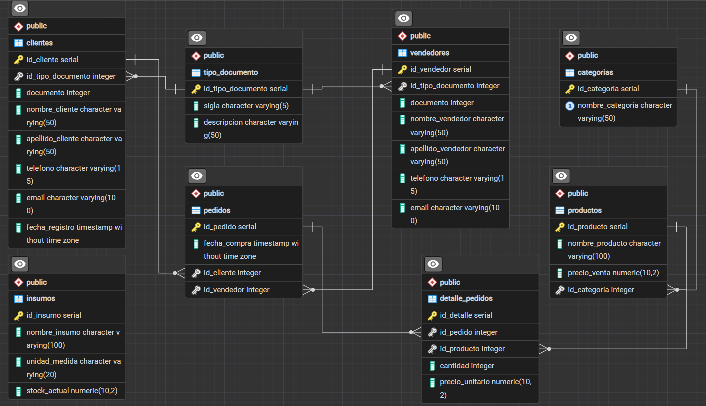

# Administración de cafetería · Flask + PostgreSQL

Aplicación web para consultar, crear, editar y eliminar registros de las ocho tablas de la base de datos `admin_cafeteria_db`: `tipo_documento`, `clientes`, `vendedores`, `categorias`, `productos`, `insumos`, `pedidos` y `detalle_pedidos`.

**Autores:** Oscar Andrés Horta Bonilla · María Luisa Rojas Vargas

**Tecnologías:** Python 3.10+, Flask 3, psycopg2, PostgreSQL, python-dotenv, Bootstrap 5 y Bootstrap Icons (desde CDN).

## Estructura

```
admin_cafeteria/
├── app.py                # Punto de entrada: crea la app, registra los blueprints y el panel de inicio
├── config.py             # Lee la configuración del archivo .env
├── db.py                 # Conexión a PostgreSQL y funciones query / execute
├── validators.py         # Validaciones de los formularios
├── routes/               # Un blueprint por módulo
│   ├── clientes.py
│   ├── configuracion.py
│   ├── insumos.py
│   ├── pedidos.py
│   ├── productos.py
│   └── vendedores.py
├── templates/
│   ├── base.html         # Plantilla común: menú, mensajes, Bootstrap
│   ├── macros.html       # Botones y encabezados reutilizables
│   ├── index.html        # Panel de inicio
│   ├── 404.html          # Página no encontrada
│   ├── error_db.html     # Error de conexión con la base de datos
│   ├── clientes/         # list.html, form.html
│   ├── configuracion/    # list.html, form.html, categoria_form.html
│   ├── insumos/          # list.html, form.html
│   ├── pedidos/          # list.html, form.html, detalle.html, ver.html
│   ├── productos/        # list.html, form.html
│   └── vendedores/       # list.html, form.html
├── static/css/styles.css # Estilos propios
├── db/
│   └── admin_cafeteria_db.sql   # Script de creación de las tablas
├── images/
│   └── db.png            # Diagrama de la base de datos
├── requirements.txt      # Librerías de la aplicación
└── .gitignore            # Excluye venv/, .env y __pycache__/
```

## Base de datos



| Tabla | Descripción | Relaciones |
|---|---|---|
| `tipo_documento` | Catálogo de tipos de documento (CC, CE, TI, PP…) | — |
| `clientes` | Clientes de la cafetería | → `tipo_documento` |
| `vendedores` | Personal que atiende los pedidos | → `tipo_documento` |
| `categorias` | Categorías de productos (nombre único) | — |
| `productos` | Productos a la venta con su precio | → `categorias` |
| `insumos` | Materias primas y su stock actual | — |
| `pedidos` | Cabecera de cada venta (fecha, cliente, vendedor) | → `clientes`, `vendedores` |
| `detalle_pedidos` | Productos, cantidades y precio de cada pedido | → `pedidos`, `productos` |

## Instalación en Windows

**Requisitos:** Python 3.10 o superior y PostgreSQL (con pgAdmin).

1. Abre PowerShell en la carpeta del proyecto:
   ```powershell
   cd C:\ruta\a\admin_cafeteria
   ```
2. Crea y activa el entorno virtual, e instala las librerías:
   ```powershell
   python -m venv venv
   .\venv\Scripts\Activate.ps1
   pip install -r requirements.txt
   ```
   Si PowerShell bloquea la activación, ejecuta antes:
   `Set-ExecutionPolicy -Scope Process -ExecutionPolicy Bypass`
3. Crea la base de datos y las tablas. En pgAdmin: crea una base llamada `admin_cafeteria_db`, abre **Query Tool**, carga el archivo `db/admin_cafeteria_db.sql` y ejecútalo.
   O desde la terminal:
   ```powershell
   psql -U postgres -c "CREATE DATABASE admin_cafeteria_db;"
   psql -U postgres -d admin_cafeteria_db -f db/admin_cafeteria_db.sql
   ```
4. Crea un archivo `.env` en la raíz del proyecto con tus datos de PostgreSQL (los mismos que usas en pgAdmin):
   ```
   SECRET_KEY=escribe-una-clave-larga-y-secreta
   DB_HOST=localhost
   DB_PORT=5432
   DB_NAME=admin_cafeteria_db
   DB_USER=postgres
   DB_PASSWORD=tu_contraseña
   ```
   > El archivo `.env` contiene credenciales y **no se sube a GitHub** (está en `.gitignore`).

## Ejecutar

```powershell
.\venv\Scripts\Activate.ps1
python app.py
```

Abre **http://127.0.0.1:5000**

> Si el puerto 5000 está ocupado, cambia el valor de `port=` al final de `app.py`.

## Qué hace cada pantalla

| Módulo | El listado muestra | El formulario pide |
|---|---|---|
| Inicio | Ventas del día, ventas totales, pedidos totales, pedidos de hoy y productos más vendidos hoy | — |
| Pedidos | Cliente, vendedor y total de cada pedido; detalle de sus productos | Cliente, vendedor y productos con su cantidad |
| Productos | Categoría, precio en pesos y producto más vendido | Nombre, categoría (lista desplegable) y precio de venta |
| Clientes | Documento, nombre, teléfono, email, fecha de registro, nº de pedidos; clientes nuevos del mes y cliente más frecuente | Tipo de documento (lista), documento, nombre, apellido, teléfono y email |
| Vendedores | Documento, contacto y total vendido; pedidos atendidos hoy y vendedor con más pedidos hoy | Tipo de documento (lista), documento, nombre, apellido, teléfono y email |
| Insumos | Unidad de medida, stock e insumo con menos stock | Nombre, unidad (lista fija: kg, lb, gramos, ml, litros) y stock |
| Configuración | Tipos de documento (con cuántos registros los usan) y categorías (con su nº de productos) | Sigla y descripción del tipo; nombre de la categoría |

## Detalles de diseño

- **Estructura por capas:** la configuración (`config.py`), el acceso a datos (`db.py`), las validaciones (`validators.py`), las rutas (`routes/`) y las vistas (`templates/`) están separadas. La aplicación se construye con el patrón *application factory* (`create_app`) y cada módulo es un *Blueprint*.
- **Consultas parametrizadas** (`%s` y `%(nombre)s`) en todas las sentencias SQL, para evitar la inyección SQL.
- **Validación en el servidor** de todos los formularios, además de los atributos `required` y `maxlength` del navegador. Los campos de texto, enteros y decimales respetan los largos y rangos de las columnas.
- **Integridad referencial:** las llaves foráneas usan `ON DELETE RESTRICT`, así que no se puede eliminar, por ejemplo, un cliente con pedidos o un tipo de documento en uso. La aplicación lo informa con un mensaje en lugar de fallar. Solo `detalle_pedidos` se elimina en cascada junto con su pedido.
- **Errores de la base de datos** (duplicados, llaves foráneas, valores fuera de rango) se traducen a mensajes en español en `db.py`.
- **Eliminar siempre usa POST** y pide confirmación.
- **Post/Redirect/Get:** después de guardar, la aplicación redirige al listado, de modo que recargar la página no duplica registros.
- **Precio histórico:** `detalle_pedidos.precio_unitario` guarda el precio del producto en el momento de la venta, así que un cambio posterior de precio no altera las ventas anteriores.
- **Totales calculados:** el total de cada pedido no se almacena; se calcula con `SUM(cantidad * precio_unitario)`, lo que evita datos inconsistentes.
- **Filtro `pesos`:** muestra los valores como `$ 3.200.000`.
- **Dinero y cantidades con `Decimal`**, no `float`, para evitar errores de redondeo.

## Alcance y limitaciones

- La aplicación no tiene inicio de sesión ni roles de usuario.
- Los formularios no incluyen token CSRF.
- No hay pruebas automáticas.
- `app.run(debug=True)` es solo para desarrollo; no debe usarse en producción.

## Autores

- Oscar Andrés Horta Bonilla
- María Luisa Rojas Vargas
